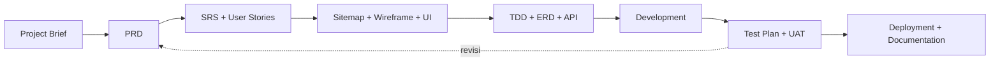

# Standar Workflow Pengembangan Website

Panduan ini merangkum alur profesional membuat website, baik untuk website organisasi, company profile, sistem informasi, maupun aplikasi web. Prosesnya tidak langsung masuk ke coding, tetapi mengikuti tahapan **Software Development Life Cycle (SDLC)** yang dilengkapi dokumen perencanaan, desain, teknis, pengujian, dan pemeliharaan.

## Daftar Isi

1. [Tahapan membuat website](#1-tahapan-membuat-website-dari-awal-sampai-selesai)
2. [Dokumen yang dibutuhkan](#2-dokumen-apa-saja-yang-dibutuhkan)
3. [Alur hubungan antardokumen](#3-alur-hubungan-antardokumen)
4. [Struktur folder dokumentasi](#4-contoh-struktur-folder-dokumentasi-proyek)
5. [Dokumen minimum berdasarkan skala proyek](#5-dokumen-minimum-berdasarkan-skala-proyek)
6. [Menyusun workflow sendiri](#6-menyusun-standar-workflow-sendiri)

---

## 1. Tahapan membuat website dari awal sampai selesai

| No | Tahap | Kegiatan | Dokumen |
| -- | ----- | -------- | ------- |
| 1 | **Discovery & Requirement Gathering** | Mengidentifikasi masalah, tujuan website, target pengguna, kebutuhan bisnis, dan batasan proyek | Project Brief, Stakeholder Analysis, User Research |
| 2 | **Planning & Product Definition** | Menentukan fitur, ruang lingkup, prioritas, target waktu, dan indikator keberhasilan | PRD, Scope of Work, Product Roadmap |
| 3 | **System Analysis** | Memetakan alur kerja pengguna, kebutuhan sistem, aturan bisnis, dan hak akses | SRS, Use Case, User Stories, Business Rules |
| 4 | **Information Architecture & UX Design** | Menyusun struktur halaman, navigasi, user flow, dan wireframe | Sitemap, User Flow, Wireframe |
| 5 | **UI Design & Prototyping** | Membuat tampilan visual, komponen UI, desain responsif, dan prototipe interaktif | UI Design, Design System, Prototype |
| 6 | **Technical Planning & Architecture** | Menentukan teknologi, arsitektur aplikasi, database, API, keamanan, dan infrastruktur | TDD, ERD, API Specification, Architecture Diagram |
| 7 | **Development / Implementation** | Membangun frontend, backend, database, autentikasi, integrasi, dan fitur website | Development Tasks, Coding Standards, README, Git Workflow |
| 8 | **Testing & Quality Assurance** | Memeriksa fungsionalitas, tampilan, keamanan, performa, dan kompatibilitas perangkat | Test Plan, Test Cases, Bug Report, UAT |
| 9 | **Deployment & Launch** | Menyiapkan server, domain, SSL, konfigurasi produksi, backup, dan peluncuran | Deployment Plan, Environment Configuration, Release Notes |
| 10 | **Maintenance & Evaluation** | Memantau error, memperbaiki bug, memperbarui dependensi, dan mengembangkan fitur lanjutan | Maintenance Log, Monitoring Report, Change Request |

---

## 2. Dokumen apa saja yang dibutuhkan?

Tidak semua proyek membutuhkan seluruh dokumen. Untuk proyek profesional, dokumen dapat dikelompokkan menjadi beberapa kategori berikut.

### A. Dokumen perencanaan produk

**1. Project Brief**
Dokumen ringkas yang menjelaskan latar belakang, masalah, tujuan, target pengguna, solusi, dan gambaran proyek.
*Menjawab: Mengapa website ini dibuat?*

**2. PRD — Product Requirements Document**
Menjelaskan kebutuhan produk secara menyeluruh: fitur, pengguna, skenario penggunaan, prioritas, kriteria penerimaan, dan indikator keberhasilan.
*Menjawab: Produk apa yang harus dibuat dan bagaimana produk itu seharusnya bekerja?*

**3. Scope of Work (SOW)**
Menetapkan batas pekerjaan: apa yang termasuk, apa yang tidak termasuk, deliverables, timeline, dan tanggung jawab.
*Menjawab: Sejauh mana proyek ini dikerjakan?*

**4. Product Roadmap & Project Plan**
Berisi milestone, jadwal pengerjaan, urutan pengembangan, pembagian tugas, dan target rilis.

### B. Dokumen analisis sistem

| Dokumen | Fungsi |
| ------- | ------ |
| SRS — Software Requirements Specification | Spesifikasi kebutuhan fungsional dan nonfungsional sistem |
| User Stories | Kebutuhan dari sudut pandang pengguna |
| Use Case Diagram | Interaksi antara aktor dan sistem |
| Activity Diagram / Flowchart | Alur proses atau aktivitas sistem |
| Business Rules | Ketentuan dan logika bisnis |
| Acceptance Criteria | Kriteria yang harus dipenuhi fitur agar diterima |
| Non-Functional Requirements | Standar performa, keamanan, aksesibilitas, dan keandalan |

> **Perbedaan PRD dan SRS:** PRD lebih berfokus pada kebutuhan produk dan nilai bagi pengguna, sedangkan SRS menjelaskan persyaratan sistem dengan lebih terperinci dan terukur. Pada proyek kecil, keduanya boleh digabung.

### C. Dokumen UI/UX dan desain

| Dokumen / Artefak | Fungsi |
| ----------------- | ------ |
| Sitemap | Struktur halaman website |
| User Flow | Perjalanan pengguna saat menyelesaikan tugas |
| Wireframe | Kerangka tata letak halaman |
| UI Mockup | Desain visual halaman |
| Interactive Prototype | Simulasi interaksi sebelum coding |
| Design System | Warna, tipografi, tombol, komponen, dan aturan desain |
| Responsive Design Specification | Aturan tampilan desktop, tablet, dan mobile |

### D. Dokumen teknis dan arsitektur

| Dokumen | Isi utama |
| ------- | --------- |
| TDD — Technical Design Document | Rancangan implementasi teknis |
| System Architecture Diagram | Hubungan frontend, backend, database, layanan eksternal, dan server |
| ERD — Entity Relationship Diagram | Struktur tabel dan relasi database |
| Data Dictionary | Definisi kolom, tipe data, dan aturan data |
| API Specification | Endpoint, parameter, autentikasi, request, dan response |
| Security Requirements | Kontrol akses, proteksi data, autentikasi, dan ancaman keamanan |
| Coding Standards | Aturan penulisan kode dan struktur proyek |
| ADR — Architecture Decision Record | Catatan keputusan teknis dan alasannya |

> **Catatan:** TDD di sini berarti *Technical Design Document*, bukan *Test-Driven Development*.

### E. Dokumen pengujian

| Dokumen | Fungsi |
| ------- | ------ |
| Test Plan | Strategi, cakupan, dan jadwal pengujian |
| Test Cases | Langkah pengujian beserta hasil yang diharapkan |
| Bug / Issue Report | Catatan masalah dan status perbaikan |
| UAT — User Acceptance Testing | Validasi oleh pemilik produk atau pengguna |
| Performance Test Report | Hasil pengujian kecepatan dan beban |
| Security Test Report | Hasil pemeriksaan keamanan |

### F. Dokumen deployment dan pemeliharaan

- **Deployment Plan** — tahapan rilis ke server produksi.
- **Environment Configuration** — konfigurasi development, staging, dan production.
- **README / Setup Guide** — cara instalasi dan menjalankan proyek.
- **User Manual** — panduan penggunaan untuk pengguna atau administrator.
- **Admin Guide** — panduan pengelolaan sistem.
- **Backup & Recovery Plan** — prosedur pencadangan dan pemulihan.
- **Release Notes / Changelog** — catatan perubahan versi.
- **Maintenance Log** — riwayat pemeliharaan dan perbaikan.

---

## 3. Alur hubungan antardokumen

Dokumen-dokumen tersebut bukan sekadar kumpulan file. Setiap dokumen menjadi acuan bagi tahapan selanjutnya.

| Urutan | Dokumen | Menghasilkan |
| ------ | ------- | ------------ |
| 01 | Project Brief | Tujuan dan masalah |
| 02 | PRD | Kebutuhan produk |
| 03 | SRS + User Stories | Persyaratan sistem |
| 04 | Sitemap + Wireframe + UI | Rancangan pengalaman dan tampilan |
| 05 | TDD + ERD + API | Rancangan teknis |
| 06 | Development | Implementasi kode |
| 07 | Test Plan + UAT | Validasi kualitas |
| 08 | Deployment + Documentation | Rilis dan operasional |



Alurnya dapat berulang. Contohnya, hasil pengujian bisa memunculkan perubahan fitur, sehingga PRD atau desain perlu diperbarui. Karena itu, dokumen harus dikelola sebagai **acuan yang hidup**, bukan hanya dibuat di awal.

---

## 4. Contoh struktur folder dokumentasi proyek

Jika kamu mengerjakan website menggunakan Laravel, React, Next.js, atau stack lainnya, dokumentasinya bisa disusun seperti ini:

```text
project-website/
├── docs/
│   ├── 01-planning/
│   │   ├── project-brief.md
│   │   ├── prd.md
│   │   ├── scope-of-work.md
│   │   └── project-plan.md
│   ├── 02-requirements/
│   │   ├── srs.md
│   │   ├── user-stories.md
│   │   ├── use-cases.md
│   │   └── business-rules.md
│   ├── 03-design/
│   │   ├── sitemap.md
│   │   ├── user-flows.md
│   │   └── design-system.md
│   ├── 04-technical/
│   │   ├── architecture.md
│   │   ├── database-erd.md
│   │   ├── data-dictionary.md
│   │   └── api-specification.md
│   ├── 05-testing/
│   │   ├── test-plan.md
│   │   ├── test-cases.md
│   │   └── uat.md
│   ├── 06-deployment/
│   │   ├── deployment.md
│   │   ├── backup-recovery.md
│   │   └── release-notes.md
│   └── 07-maintenance/
│       └── maintenance-log.md
├── README.md
├── src/ atau app/
├── tests/
└── ...
```

Struktur ini fleksibel. Diagram visual bisa disimpan sebagai SVG/PNG, desain di Figma, dan spesifikasi API bisa memakai OpenAPI. Tidak semua artefak harus berupa Markdown.

---

## 5. Dokumen minimum berdasarkan skala proyek

| Dokumen | Landing page | Company profile | Sistem informasi |
| ------- | ------------ | --------------- | ---------------- |
| Project Brief | Ya | Ya | Ya |
| PRD | Ringkas | Ya | Ya |
| Sitemap & Wireframe | Ya | Ya | Ya |
| UI Design | Ya | Ya | Ya |
| SRS / User Stories | Ringkas | Ringkas | Ya |
| ERD & API Specification | Jika perlu | Jika perlu | Umumnya ya |
| Test Plan & Test Cases | Ringkas | Ya | Ya |
| Deployment & README | Ya | Ya | Ya |
| Security & Backup Plan | Dasar | Dasar | Lebih terperinci |
| UAT | Jika perlu | Jika perlu | Umumnya ya |

> **Saran praktis:** Jangan membuat seluruh dokumen secara formal sebelum tahu skala proyek.
> - **Website sederhana:** satu PRD ringkas yang dilengkapi sitemap, desain, dan checklist pengujian bisa cukup.
> - **Aplikasi dengan login, dashboard, role pengguna, transaksi, atau data sensitif:** analisis kebutuhan, rancangan teknis, pengujian, serta keamanan perlu lebih terperinci.

---

## 6. Menyusun standar workflow sendiri

Panduan ini bisa dijadikan paket dokumentasi yang dipakai berulang untuk setiap proyek website. Tandai pilihan yang sesuai agar struktur dokumennya cocok dengan workflow-mu.

**1. Jenis website**

- [ ] Landing page / company profile
- [ ] Sistem informasi dengan login, dashboard, dan database
- [ ] Marketplace / SaaS / aplikasi web kompleks
- [ ] Workflow universal untuk semua jenis website

**2. Metode pengembangan**

- [ ] Coding manual dengan workflow developer
- [ ] AI-assisted development menggunakan Claude, Gemini, atau ChatGPT
- [ ] AI coding agent yang mengerjakan proyek berdasarkan dokumen dan instruksi

**3. Kedalaman dokumentasi**

- [ ] Ringkas — hanya dokumen wajib
- [ ] Lengkap — standar profesional
- [ ] Enterprise — governance, keamanan, audit, dan versioning

**4. Cara kerja tim**

- [ ] Dikerjakan sendiri
- [ ] Tim kecil (2–5 orang)
- [ ] Tim lintas fungsi (PM, UI/UX, developer, QA)
